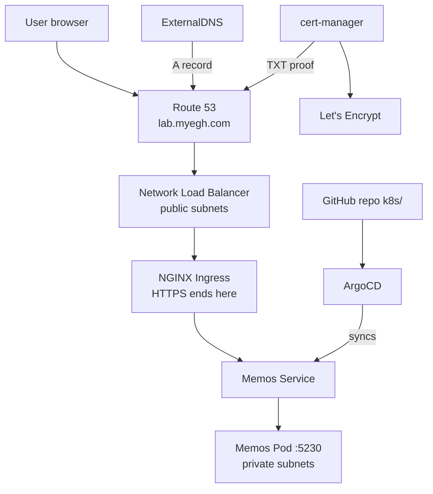

# EKS Memos Deployment

Memos deployed on AWS EKS with Terraform, Helm, ArgoCD, HTTPS and automatic DNS. Live at `https://app.lab.myegh.com` (when the cluster is running).

## Architecture



## Tools

| Tool | Purpose |
|---|---|
| Terraform | Builds VPC, EKS, IAM roles, Helm releases |
| Helm | Installs NGINX Ingress, cert-manager, ExternalDNS, ArgoCD |
| IRSA | Gives cert-manager and ExternalDNS Route 53 access, no keys stored |
| ArgoCD | GitOps: keeps the cluster matching `k8s/` in GitHub |
| GitHub Actions | CI: Terraform checks, Checkov, Trivy |
| pre-commit | Local checks before every commit |

## How to run

```
make apply     # build everything and deploy the app through ArgoCD
make destroy   # remove everything in the safe order, then check costs
make check     # confirm nothing is left running
```

## Problems solved

| Problem | Cause | Fix |
|---|---|---|
| Helm install "forbidden" | Charts installed before admin access was ready | `depends_on = [module.eks]` |
| Certificate failed (NXDOMAIN) | DNS name looked up before it existed, so "doesn't exist" was cached | Create DNS first, lower SOA negative TTL to 60s |
| 502 Bad Gateway | Service named `memos` injected `MEMOS_PORT`, clashing with Memos | `enableServiceLinks: false`, set `MEMOS_PORT` |
| Destroy stuck on VPC | Load balancer created by Kubernetes, not Terraform | Destroy NGINX first (`make destroy` does this) |
